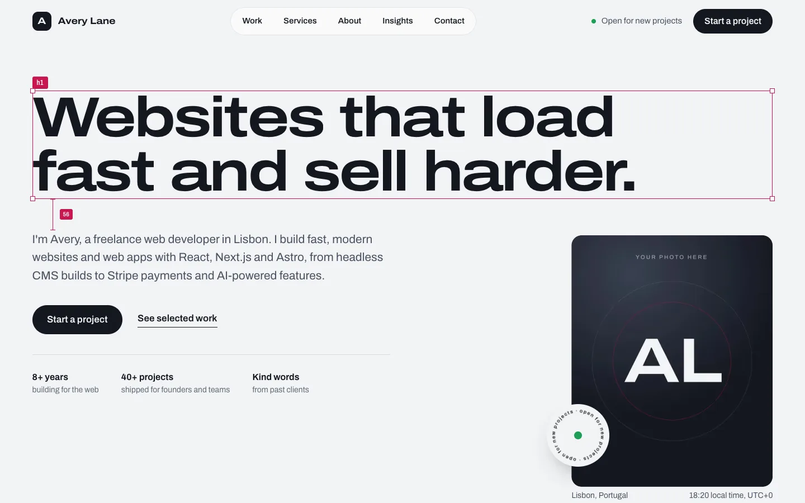

<div align="center">

# Astro Freelance Portfolio

**A fast, animated portfolio template for freelance developers — built to win clients, not just look nice.**

Case studies, service pages that rank for "hire a … developer", a contact form that lands in your inbox,
and SEO plus AI-assistant discoverability (JSON-LD and `llms.txt`) wired in from day one.


[](https://vercel.com/new/clone?repository-url=https%3A%2F%2Fgithub.com%2Fzuandabaransyahputra%2Fastro-freelance-portfolio&env=RESEND_API_KEY,CONTACT_FROM,CONTACT_TO&envDescription=All%20optional%3A%20Resend%20key%20and%20addresses%20for%20the%20contact%20form&project-name=my-portfolio&repository-name=my-portfolio)

</div>

<p align="center">
  
</p>

Everything you see is sample content: the person ("Avery Lane"), the projects (Northwind Coffee, Acme
Analytics, …), the testimonials and the screenshots are fictional placeholders, generated for this
template. Swap in your own and ship.

## Features

**Pages**

| Page | What it does |
| --- | --- |
| Home (`/`) | Hero with proof points, client marquee, a tilted 3D showreel of screenshots, sticky stacked case studies, services, about, testimonials, latest insights |
| Work (`/works`) | Every project with category filters (kept in `?filter=`) |
| Case studies (`/work/<slug>`) | Overview, challenge, approach, build, results, a client quote, sticky table of contents and a "next project" link |
| Services (`/services`, `/services/<slug>`) | One page per service, written for hiring searches, with related work, "how hiring works" and an FAQ |
| Insights (`/insights`, `/insight/<slug>`) | Articles built from blocks (paragraph, heading, figure, pull quote), with a reading progress bar |
| Contact (`/contact`) | A project brief form (type, budget, timeline), direct channels and your local time |
| Privacy policy, 404 | The 404 is `noindex` |

**Motion** (all in one file, `src/scripts/motion.ts`, and all of it respects `prefers-reduced-motion`)

- Smooth scrolling with [Lenis](https://lenis.darkroom.engineering) and page transitions with Astro's `<ClientRouter />`
- Project screenshots that morph from a card into the case-study hero
- A custom cursor that says "View" over projects, magnetic buttons
- A headline that rises word by word inside a design-tool selection box; a portrait that wipes in
- A looping 3D showreel wall that drifts with the scroll; sticky case-study cards that stack and shrink
- Word-by-word heading reveals, an About statement that lights up as you read, a testimonial slider,
  floating previews over insight rows
- Mobile-first products shown on two phones; everything else in a browser frame tinted with the brand colour

**SEO and GEO** (generative engine optimisation)

- Canonical URLs without a trailing slash, Open Graph and Twitter cards on every page
- One JSON-LD `@graph` per page: `WebSite`, `Person` and `ProfessionalService`, plus `CreativeWork` on case
  studies, `BlogPosting` on articles and `Service` on service pages, each with a `BreadcrumbList`
- `FAQPage` structured data on the contact and service pages
- `/sitemap.xml`, `/robots.txt` and [`/llms.txt`](https://llmstxt.org) generated from the same data as the pages,
  so new projects and articles appear automatically, and AI assistants get a clean summary of who you are and how to hire you
- A 1200×630 share image rendered from HTML (`npm run og`)

**Contact form**

- Posts to `/api/contact`, the only server route (a Vercel Function); every other page is static
- Delivered with [Resend](https://resend.com), with the visitor's address as reply-to
- Branded HTML emails: a notification for you and an optional confirmation for the visitor, with your next steps
- Honeypot field, minimum fill time and a per-IP rate limit
- If sending fails, the visitor's email app opens with the brief filled in, so no lead is lost
- Optional "Send on WhatsApp" button

**Stack:** Astro 7 (no UI framework, just `.astro` components), Archivo Variable via Fontsource,
`astro:assets` for responsive AVIF/WebP, `@astrojs/vercel`.

## Quick start

```bash
npm install
npm run dev       # http://localhost:4321
npm run build     # static pages + the contact function in .vercel/output
npm run preview
```

Requires Node 22.23.4 or newer.

## Make it yours

Work through this list top to bottom; the first two files cover most of it.

1. **`src/config.ts`** — your name, monogram, role, site URL, email, socials, location and time zone,
   availability text, response time, currency and the contact form's budget, type and timeline options.
   Set `whatsapp` to show WhatsApp links. Everything else reads from here, including the favicon,
   JSON-LD, `llms.txt` and the emails.
2. **`src/data/site.ts`** — hero headline, intro and proof points, client names, services (each becomes a
   `/services/<slug>` page), hiring steps, FAQ, about text, testimonials and the privacy policy.
3. **`src/assets/portrait.webp`** — replace the initials placeholder with your photo (portrait, roughly 4:5).
4. **`src/data/projects.ts`** + **`src/assets/projects/`** — your projects. Screenshots work best at about
   3200 × 2340. Add a `caseStudy` to get a `/work/<slug>` page; without one the card links to `url`.
   Pick a `tint` from the client's brand and `device: 'phone'` for mobile-first products.
   `featuredSlugs` picks the stacked case studies on the home page.
5. **`src/data/insights.ts`** + **`src/assets/insights/`** — your articles (or delete them all and remove the
   Insights link from `nav` in `site.ts`).
6. **Testimonials** — the two in `site.ts` are samples. Replace them with words your clients approved, or
   empty the array to hide the section. Set `project` to a slug to show the quote on that case study too.
7. **`og/og.html`** — headline and proof points on the share image; then run `npm run og` (see below).
8. **Colours and type** — tokens at the top of `src/styles/global.css` (`--ink`, `--paper`, `--accent`, …).
   The email colours are in `src/lib/emails.ts`, the favicon in `src/pages/favicon.svg.ts`.

### Share image

`npm run og` renders `og/og.html` to `public/og.jpg`, filling `{{name}}`, `{{monogram}}`, `{{host}}` and
`{{availability}}` from `src/config.ts`. It needs Playwright: either `npm i -D playwright && npx playwright install chromium`,
or `playwright-core` with `CHROME_PATH` pointing at an installed Chrome:

```bash
CHROME_PATH="/Applications/Google Chrome.app/Contents/MacOS/Google Chrome" npm run og
```

## Environment variables

All optional. Without `RESEND_API_KEY` the site still builds and the form falls back to opening the
visitor's email app. See `.env.example`.

| Variable | Purpose |
| --- | --- |
| `SITE_URL` | Production URL; overrides `url` in `src/config.ts` (canonical links, sitemap, JSON-LD, emails) |
| `RESEND_API_KEY` | Resend API key (the Resend integration on the Vercel Marketplace sets it for you) |
| `CONTACT_FROM` | Sender on a domain verified in Resend, e.g. `Your Name <hello@your-domain.com>`. Until it is set, Resend's test sender is used, which only delivers to your Resend account's own address. Also turns on the confirmation email to the visitor |
| `CONTACT_TO` | Inbox that receives briefs; defaults to `email` in `src/config.ts` |

## Deploy to Vercel

[](https://vercel.com/new/clone?repository-url=https%3A%2F%2Fgithub.com%2Fzuandabaransyahputra%2Fastro-freelance-portfolio&env=RESEND_API_KEY,CONTACT_FROM,CONTACT_TO&envDescription=All%20optional%3A%20Resend%20key%20and%20addresses%20for%20the%20contact%20form&project-name=my-portfolio&repository-name=my-portfolio)

1. Click the button (or "Use this template" on GitHub and import the new repo in Vercel).
2. Add your domain in the Vercel project, and set `url` in `src/config.ts` (or `SITE_URL`) to match.
3. For the contact form, add Resend from the Vercel Marketplace (it sets `RESEND_API_KEY`), verify your
   domain in Resend and set `CONTACT_FROM`.
4. To send `www` to the apex domain (or the other way round), use the redirect option in Vercel's domain settings.

Or from the CLI: `vercel deploy --prod`. Pages are prerendered and `@astrojs/vercel` turns `/api/contact`
into the one function. URLs have no trailing slash (`trailingSlash: 'never'` in Astro, `false` in `vercel.json`).

Hosting elsewhere? Swap the adapter (for example `@astrojs/netlify` or `@astrojs/node`); the API route is a
standard Astro endpoint.

## Project structure

```text
src/
├── config.ts            # who you are: name, contact, socials, location, form options
├── data/
│   ├── site.ts          # hero, services, hiring steps, FAQ, about, testimonials, privacy
│   ├── projects.ts      # projects and case studies
│   └── insights.ts      # articles as blocks
├── assets/              # portrait, project screenshots, insight art (optimised by Astro)
├── components/          # Hero, Showreel, FeaturedStack, ProjectCard, ProjectMedia, Testimonials, …
├── layouts/Base.astro   # <head>, meta tags and the JSON-LD graph
├── lib/emails.ts        # HTML emails sent by the contact form
├── pages/               # routes, plus api/contact.ts, sitemap.xml, robots.txt, llms.txt, favicon.svg
├── scripts/motion.ts    # all interaction code
└── styles/global.css    # tokens, type, buttons, reveals, cursor
og/og.html               # source of public/og.jpg
scripts/build-og.mjs     # renders the share image
```

## License

[MIT](LICENSE). Use it for your own portfolio or your clients'. A credit link is appreciated but not
required; remove the "Template by" line in `src/components/Footer.astro` if you like.

---

<p align="center">
  Built by Zuanda Baransyah Putra — <a href="https://zuanda.web.id">https://zuanda.web.id</a>
</p>
